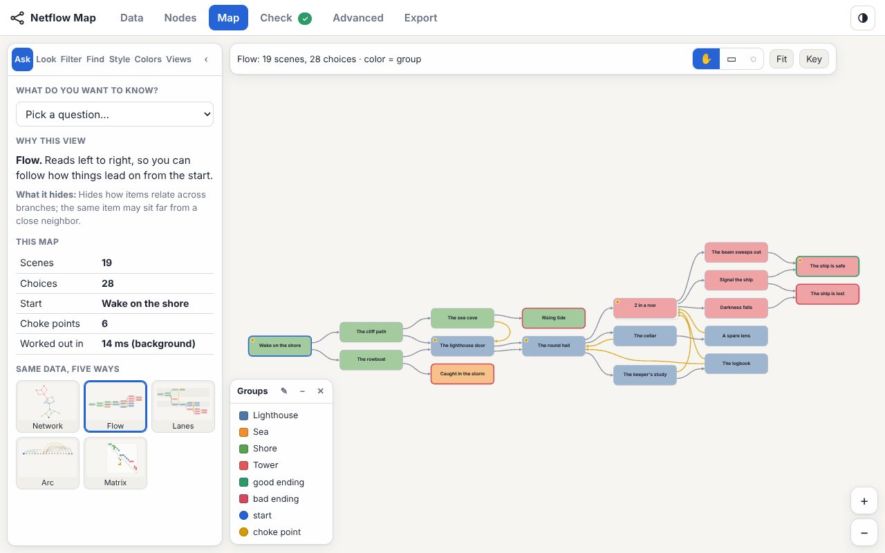
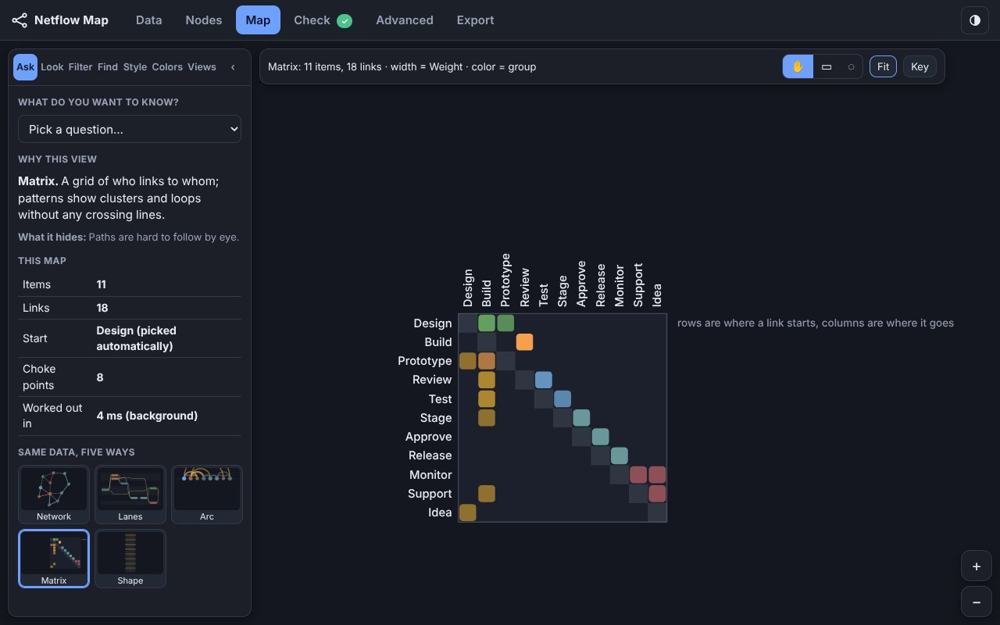
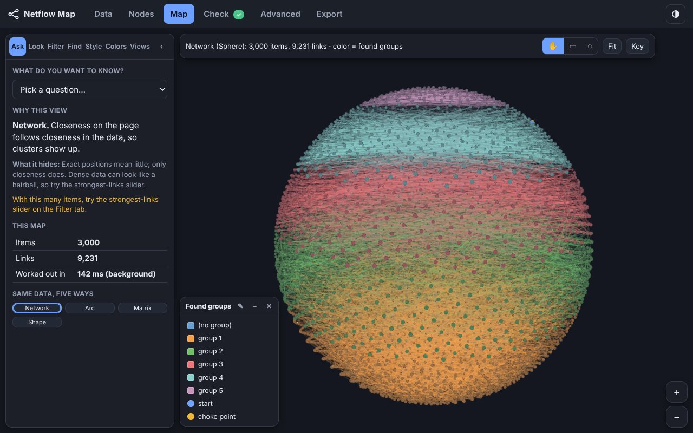
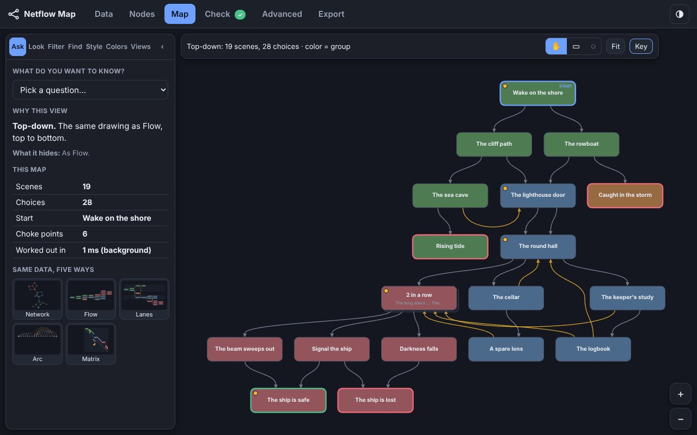

<div align="center">

# Netflow Map

**Turn a list of links into a map you can read and explore. One file, offline, up to 100,000 items.**

    

</div>

Copyright (c) 2026 LFC Foundry. MIT License. Forged by LFC Foundry.

## What it is and how it works

Netflow Map is a free tool for seeing and analyzing how things connect and flow. It works with any kind of linked data: links and nodes, edges and vertices, pages and choices.

How it works:

1. **Read:** tables, Excel, JSON, outlines, Markdown notes, graph files, or a zip of them.
2. **Lay out:** nine views, each answering a different question, with no two items touching.
3. **Analyze:** find choke points, check the data, and simulate how flows spread.
4. **Share:** export pictures, data, an animated GIF or a one-page report.

It is one file that runs in your browser. Nothing is uploaded or installed.

## Why it exists

Data about connections usually lives in lists, and a list hides its shape: what everything depends on, where flows pile up, which groups barely touch. Netflow Map draws that shape quickly and clearly, so the signal stands out from the noise, even at 100,000 items.

It runs in the browser because almost every device has one. So it works offline and on locked-down computers, and your data stays with you.

Where it helps:

- **Software systems:** which services depend on which.
- **Processes:** where work waits, and which steps every job must pass.
- **Supply chains and money flows:** how routes shift over time.
- **Linked notes and wikis:** hubs, clusters and links to missing notes.
- **Branching stories:** which endings people reach, and how often.
- **Research networks:** citations, co-authors and other edge lists.

<div align="center">

<table>
<tr>
<td align="center" valign="top"><br><sub>Flow: how things lead on from the start</sub></td>
<td align="center" valign="top"><br><sub>Matrix: who links to whom, with no crossing lines</sub></td>
</tr>
<tr>
<td align="center" valign="top" colspan="2"><br><sub>Network: 288 systems and 712 links, with no two items touching</sub></td>
</tr>
<tr>
<td align="center" valign="top"><br><sub>3D sphere: 3,000 items and 9,231 links, turned by dragging</sub></td>
<td align="center" valign="top"><br><sub>Top-down: Flow read from top to bottom</sub></td>
</tr>
</table>

</div>

## Highlights

| Nine views | No two items touch | Reads almost anything | Simulation |
|---|---|---|---|
| Flow, top-down, choke points, lanes, shape, Sankey, arc, matrix and network. | Every network arrangement ends with a step that guarantees it, and a test checks it. | CSV, JSON, outlines, Excel, GraphML, GEXF, DOT, zips and Markdown notes. All 23 file kinds are opened in every browser test. | Up to 100,000 walkers with exact odds, error bars and what-if ranking. |

## Against d3-force, ForceAtlas2 and Cytoscape.js

The same network (about 3 links per item, with groups) laid out by each library in the browser, Chromium 155, median of 3 runs (one run when over 600 ms). Every layout is drawn with Netflow Map's item sizes. Details: docs/BENCHMARKS.md section 67.

| 10,000 items | Layout time | Items touching |
|---|---:|---:|
| **Netflow Map** | **413 ms** | **0%** |
| d3-force | 17.4 s | 20.9% |
| d3-force + collide | 22.7 s | 23.7% |
| ForceAtlas2 | 18.8 s | 3.7% |

At 10,000 items Netflow Map was 42 times faster than the fastest library in Chromium, 35 in Firefox 158 and 30 in WebKitGTK 2.52.6. Cytoscape.js (cose) took 20.9 s at 1,000 items against 131 ms.

## Flow view against dagre and ELK

1,000 items and 1,900 links with no loops, Chromium 155: Netflow Map 30 ms, dagre 8.4 s, ELK 2.1 s. dagre and ELK cross about half as many links today (47,009 against 25,448 and 24,920); a deeper crossing search that beats both is being built.

## Sankey view against d3-sankey

1,500 items, Chromium 155: d3-sankey 43 ms, Netflow Map 91 ms (the whole build), with fewer crossings (91,896 against 95,509; 5,574 against 7,223 at 400 items). Netflow Map also handles loops, which d3-sankey refuses.

## Reading a 16 MB table against Papa Parse and d3-dsv

563,563 rows, median of 4 rotated turns. Before this build: Chromium 247 / 270 / 251 ms (Netflow Map / Papa Parse / d3-dsv), Firefox 236 / 291 / 322 ms, WebKitGTK 575 / 211 / 326 ms. Build 2026.10.31.1948 reads it 3.4 times faster in WebKitGTK (390 to 119 ms in an A/B run) and 1.4 times faster in Chromium.

## Memory to hold 100,000 items

Chromium 155, JavaScript memory after a full clean-up: Netflow Map 41 MB, graphology 71 MB, Cytoscape.js 420 MB.

## Built for big maps

On a map of 188,000 items and 563,000 links in an 800 by 600 window: a rename holds the page about 40 ms in Chromium, 22 ms in Firefox and 37 ms in WebKitGTK; the resting layout helper wakes in about 20 to 32 ms; every change is also written to the browser's database and sent to disk at once, so a crash two seconds later loses nothing; a big saved map takes 1.3 KB of the small save space every page on a site shares, not 1.7 MB.

## What it does

It has six tabs (the Map's left panel adds a Colors tab):

- **Data**: drop in files or a folder (or paste text), see in plain words what was found, and use the columns workbench: every column with its type and what it does on the map (color, size, line width, labels, filters), plus calculated columns. If the data holds the same network at several times, a States card turns one column per state (or a column naming the state on repeated links) into baseline / year 1 / year 2 / end state.
- **Nodes**: the items and links as tables you can sort, filter, edit, add to, and delete from.
- **Map**: (the **Colors** tab in its left panel changes the color of every part of the map, the type family and the sizes, with 12 ready-made looks and your own saved looks that can be shared as a file; with states: a timeline under the picture to play, pause or drag through them) nine views, a network view with several arrangements (including three 3D ones you can turn: 3D force, Distances 3D and Sphere), a floating key you can drag and edit, search, strongest-links slider, facets, route lighting, box and lasso selection, hand-moved items, right-click menus, formatting rules for items and links, saved views, and a poster print.
- **Check**: findings about the data, each with a plain-words reason, a way to see it on the map or in the table, and a fix where one is safe.
- **Advanced**: the Monte Carlo simulation (up to 100,000 walkers; start items, walker types, 16 distributions for arrivals, uncertain link weights, link costs and dwell times; exact odds with error bars beside the dice; step, cost and settling charts; what-if ranking of items or links; results as map color and link width, with optional flow dots), layout settings, and the one-button device check.
- **Export**: JSON, CSV, SVG, PNG, poster, the check report, saved views, an animated GIF for slides (plays through the states with a smooth change between them, or turns a 3D view around, with up to 25 FPS, pauses and reversals, easing, name timing and picture looks), and a one-page HTML report with the animation inside.

## What it reads

| You bring | It understands |
|---|---|
| CSV, TSV, semicolon or bar tables | A list of links (from, to, weight, label, kind, groups), items with a column that lists their links, items with a parent column, or a grid (adjacency matrix). It guesses; you can change the guess. |
| JSON | `nodes` + `links` or `edges`, Cytoscape.js, JSON Canvas, story projects (`passages` with `choices`), lists of links, `name: [targets]` lists |
| Outlines | Indented or bulleted lists, Markdown headings; `[[wiki links]]` inside lines add cross links |
| Excel (.xlsx) | Every sheet is read as its own table (dates become dates) and the sheets are merged by name, so a sheet of links and a sheet describing the items work together |
| Graph files | GraphML (including yEd labels), GEXF (Gephi), GML and Graphviz DOT (clusters become groups) |
| Zip files | A zip of any of the above, in any mix, folders and zips inside zips included; opened with safety limits (see `docs/BENCHMARKS.md`, section 9) |
| Markdown notes | Several files or a whole folder (Obsidian style): `[[links]]`, `[text](note.md)` links, aliases, tags, folders; links to notes that do not exist become placeholders |
| Arrow lines | `A -> B : label`, and simple Graphviz DOT |

Every import ends with a short report of what was kept, merged, skipped or shortened.

## The nine views

Flow, Top-down (with optional story order, tags for long links, a must-pass column, step numbers, bundled and tapered links, chapters that fold big maps, and columns for tall maps), Choke-point spine, Lanes (one band per group), Shape (the stretches between choke points), Sankey (bands as wide as the number of players who take them), Arc, Matrix, and Network (for data that is not a story).

## How it draws

The map is drawn by WebGL 2 if this browser can really use it, otherwise basic 2D drawing. (It no longer draws with WebGPU: on the owner's laptop WebGPU froze for 1.5 to 1.9 seconds at random while WebGL 2 stayed steady. WebGPU is still used for the graphics-card arrangement math, and the code and the tester keep it for comparison.) "Can really use it" means a small test runs at startup (it does not just ask the browser what it claims). All the ways draw the same picture (they agree to within about 0.2 out of 255 on average). The layout work runs in a background helper so big maps do not freeze the page. The **Check this device** button runs all of this again, times a large map, and says in plain words what to expect.

## No two items touch

Most layout tools place points. d3-force and ForceAtlas2 do not know how big an item is, so at the sizes this app draws, **70 to 100% of their items end up on top of another item** (ForceAtlas2 on a plain tree: 9%). Every network arrangement here ends with a step that guarantees that **no two items touch**: push-apart passes, then (if a pair still touches) a stretch of the whole picture, which does not change how true it is, then each leftover item moves to the nearest free spot. A test checks it (`test/layout.test.js`), and 40 layouts per browser were checked in Chromium and Firefox.

| 5,000 items, moderate network (Node, one run) | Time | Truth (lower = truer) | Items touching |
|---|---:|---:|---:|
| **Ours (Stress)** | **0.8 s** | 0.198 | **0%** |
| d3-force | 11 s | 0.182 | 98.5% |
| d3-force + forceCollide | 16 s | 0.182 | 12% |
| ForceAtlas2 | 9.8 s | 0.183 | 98% |

That guarantee costs a little truth (the score ignores item size, so it favors the others), and the benchmarks count ours with that cost included. Through 3,000 items ours is still the truest; at 10,000 items it is 10% truer to 9% less true than d3-force. `docs/BENCHMARKS.md` section 12 has the full table, how it was measured, and what the numbers do not show; `docs/RESEARCH-r-packages.md` compares the same problem across R packages.

## Build and test

```
node tools/build.mjs                 # writes a minified index.html (version stamp year.month.day.HHMM, US Eastern); needs esbuild
node tools/build.mjs --dev           # readable, larger file
node tools/build.mjs --pack          # also writes index.packed.html, a self-extracting copy (our lzma-pack module) for downloads outside git
node test/all.js                     # every Node test below, four at a time (about 25 s); add --full for the 90 s fuzz run
node test/archive.test.js            # zips, Excel and graph files, including zip bombs, bad checksums and cut-off files
node test/file-types.test.js         # every file kind the Data tab takes (23) opens as the same small map and lays out
node --expose-gc test/fuzz.test.js 90  # about 90 s of random and hostile input, layout shapes, dense links and leak loops
node test/importers.test.js          # 19 quick checks of the readers, including 6,000 random tables against a plain reader
node test/stress-wasm.test.js        # the WebAssembly Distances layout and push-apart give exactly the JavaScript picture (also with a 700-hop chain and with WebAssembly missing)
node test/force-wasm.test.js         # the WebAssembly Force rounds give exactly the JavaScript positions (2D and 3D, items on one spot, and the fallbacks)
node test/layout.test.js             # network layouts must leave no two items touching (the guarantee above)
node test/pack.test.js               # a layout sent from the helper to the page comes back exactly as the engine made it
node test/gif.test.js && node test/sim.test.js   # GIF writer (byte-identical fast path) and the random draws
node bench/overlap.js moderate 1000 3000 5000    # Node only: items left touching, ours against d3-force and ForceAtlas2 (needs bench/npm install)
node test/oracle.test.mjs            # new engine versus the older story-map package, 40 random stories
node test/limits.test.js             # a 20,000-page chain, 1,500 stacked diamonds, a 3,000-item network
sh tools/fuzz-kit/run-netflow.sh all    # random pans, zooms, setting changes, item moves and file loads in the three test browsers (12 seeds of 250 operations each, about 10 min; needs puppeteer-core, CHROME and FIREFOX set)
node test/browser.test.js chromium   # real browser run (see the file header for the browser programs it needs)
node test/browser.test.js firefox    # add NFM_HEADFUL=1 NFM_STRICT=1 NFM_VK_ICD=<a vk_*_icd.json> under xvfb-run to also run WebGL 2 and WebGPU in Firefox
NFM_ONLY=4,index node test/browser.test.js chromium   # only these blocks (seconds and ok lines per block print at the end of every run); a partial run is never a release result
node test/all.js --changed           # Node tests for the files changed since the last commit, and the NFM_ONLY= blocks of the browser test they need
sh tools/hooks/install.sh            # once per clone: house-rule commit hooks
```

## Files

- `src/engine.js`: layouts, choke points, traffic, exact odds, network layout, scores (no page needed)
- `src/importers.js`: everything that reads data
- `src/scene.js`: turns a layout into drawing lists (also writes the SVG)
- `src/render.js`: the three drawing backends
- `src/probe.js`: the startup test and the one-button device check
- `src/engine-client.js`: runs the engine in a background helper, with a fallback
- `src/columns.js`, `src/sim.js`, `src/check.js`: column types, calculated columns and states, the walker simulation, the data checks
- `src/gif.js`: the animated GIF writer (palette, frame differencing, LZW)
- `tools/build-engine-module.mjs`, `tools/check-engine-module.mjs`: cut the engine into the standalone JS-modules file `netflow-engine.js` and prove it lays out exactly the same
- `src/pack.js`: sends a big layout from the helper to the page as typed-array columns instead of copying every object
- `src/app/*.js` (joined in file-name order into one function), `src/app.css`, `src/index.template.html`: the page (00 core, 10 data, 20 nodes, 30 map, 32 interact, 35 rail, 40 states, 50 check, 60 advanced, 61 simulation, 70 export, 72 gif, 99 boot)
- `vendor/`: `netflow-layers.js` (the layered drawing; exact copy of JS-modules netflow-layers 1.5.0), `netflow-sankey.js` (the Sankey layout; exact copy of JS-modules netflow-sankey 2.3.0), `memory-compression.js` (exact copy of JS-modules memory-compression 2.6.2; the build sets `MEMORY_COMPRESSION_NO_EVAL` so it never probes `new Function`, which the page does not allow), `env-probes.js`, `back-close.js` and `field-report.js` (1.0.2: five quick taps in the top-left corner open two hidden buttons, Save speed report and Save error log; one small Markdown file each, nothing leaves the device) from [JS-modules](https://github.com/lfcfoundry/JS-modules); `tools/fuzz-kit` (1.3.3) and `tools/webkit-driver` are the random-use test runner and its WebKit driver; `story-map.global.js` is only the test oracle, it is not shipped in `index.html`

## Known limits

- Good and bad marks apply to endings (items with no way on).
- Link weights act as odds only when "Use link weights" is on.
- In loops, the map shows expected visits per player, not "share of players who saw it".
- A layered view stops above 90,000 stops and says so; use Network or Matrix instead.
- Real graphics hardware and phones are checked by hand (see Browsers used in testing).
- Sharp screens: one Chromium run at pixel ratios 1, 2 and 3 in a phone-sized window counts the map's canvas pixels (`qa-guide/pixel-ratio/dpr-check.js`). The map is drawn at up to 2 times the screen's size in points (3.92 to 2.52 M pixels at ratio 3, docs/BENCHMARKS.md section 62).

## Browsers used in testing

The automated browser test (`node test/browser.test.js`) passes in all three test browsers, one at a time: **Firefox 158.0**, **ungoogled-chromium 155.0.8059.39** and **WebKitGTK 2.52.6** (from the "browsers" branch of lfcfoundry/knowledge-base). GNOME Web 46.5 was part of the earlier runs and the tables below and was dropped from testing on 2026-10-24. By hand, the owner has also run the then-and-now tester on a midrange phone (Android 17, Chrome 155) and on a laptop with integrated graphics in Firefox 159. Safari and Windows Chromium builds have not been tested.

## Benchmarks

`bench/` runs the same jobs in Firefox and ungoogled-chromium against Papa Parse, d3-force, ForceAtlas2, dagre, ELK, Louvain, expr-eval, gifenc and more, up to 1,000,000 items. Results and findings are in `docs/BENCHMARKS.md`; the raw numbers are in `bench/results/`. `node bench/report.js` rebuilds the tables.


Headlines (both browsers; `docs/BENCHMARKS.md` has every table, the losses included):

- Stress layout: 2.4 to 12× faster than d3-force up to 3,000 items and 14 to 23× faster at 10,000, truer through 3,000 items, and the only one of the three with no overlapping items (section 12). At 10,000 items it is 10% truer to 9% less true than d3-force.
- The Arrangement panel now says in plain words what the chosen arrangement is for and, where the normal Distances uses a quick sample (4,001 to 20,000 items), offers best quality with a rough time and a one-click button.
- Graphics card in the app: "Distances, best quality" now uses the graphics card when a start-up test says it works (4,001 to 40,000 items, two smooth sweeps of the processor's own random-pair method up to about 12,000 items, the 40 majorization steps above), checks the picture for sanity, runs the page's own overlap clean-up on it, and falls back to the processor on any problem. At first start a dialog offers a short tuning test of this computer (processor against card, which method, up to what size, and real timings for the "about N seconds" notes); it can be run again from the Advanced tab. "Check this device" also times a big best-quality arrangement on the card against the processor and says in plain words whether the card works and pays off (or why it falls back). The research behind it: a 60-pivot sketch plus 30 majorization steps reaches best-quality truth, and a prototype does it all on the card with WebGPU: on a laptop with integrated graphics it is 1.4 to 4.5 times faster than the processor's best quality up to 20,000 items at the same truth, and at 30,000 items (1.7 s) it is 22% truer than the quick sample the app uses there. Up to about 12,000 items a parallel version of the processor's own random-pair sweeps (two smooth sweeps) matches or beats it (hub-heavy 10,000 items: 0.147 against the processor's 0.147; moderate: 0.163 against 0.164) in 0.3 to 0.5 s against about 1.6 s. `bench/netflow-map-tester.html` is a one-file page that runs the checks by itself on any laptop and writes a results file (docs/BENCHMARKS.md section 19).
- Force on the graphics card: the Force arrangement of a map of 20,000 or more items runs its rounds on the card (WebGPU) when a quick timing on this device says it beats the processor, and the page then does its own overlap clean-up. Same picture quality (truth 0.210 against 0.210 at 100,000 items). What to expect: laptop with integrated graphics, 100,000 items 26.2 s to 5.6 s (about 4.7 times faster; 200,000 items 2.0 times); midrange phone (Android, Chrome), slower on the card above roughly 10,000 items, so it keeps the processor. Straight links go onto the card 2 to 4 times faster on both. The same ranges are in the app under Check this device. Details: docs/BENCHMARKS.md section 41.
- Against D3 (2026-10-17): `bench/netflow-map-d3-race.html` is a one-button page that races Netflow Map against d3-force, d3-sankey and a D3 SVG / canvas drawing on the same data and writes a results file. Build it with `node tools/build-d3-race.mjs` (needs `npm install` in `bench/`). First results are in the 2026.10.17.1507 row of `CHANGELOG.md`.
- First release versus now (2026-10-18): `bench/netflow-map-then-and-now.html` is a one-button page that lays out the same made-up maps with the first stamped build and the current engine, taking turns, and prints a plain verdict; tables in `bench/then-and-now/RESULTS.md` (30,000 items 22x to 49x or more faster to lay out, small maps about the same).
- Force arrangement in Firefox: 12 to 95% faster (10,000 items: 6.7 s to 3.8 s), identical pictures; Firefox is now within 0.9 to 1.2× of Chromium on it. Section 18 compares every module of ours across the two browsers.
- Force arrangement in WebAssembly (2026-10-17, build 2026.10.17.1256): the springs-and-repulsion rounds also exist as a 7,260-byte WebAssembly program (`wasm/force.c`) that gives the **same positions to the last digit** and is 1.1 to 2.1 times faster. 10,000 items, milliseconds, **lower is better** (times faster: higher is better); 2D is 120 rounds, 3D is 90 rounds:

  | Engine | 2D JavaScript | 2D WebAssembly | 2D times faster | 3D JavaScript | 3D WebAssembly | 3D times faster |
  | --- | ---: | ---: | ---: | ---: | ---: | ---: |
| Node 22.22.0 | 4,462 | 2,540 | 1.76 | 6,873 | 3,460 | 1.99 |
| ungoogled-chromium 155.0.8059.39 | 4,734 | 2,223 | 2.13 | 5,991 | 3,258 | 1.84 |
| Firefox 158.0 | 3,895 | 2,567 | 1.52 | 7,801 | 4,044 | 1.93 |
| WebKitGTK 2.52.6 | 3,728 | 2,357 | 1.58 | 3,891 | 3,506 | 1.11 |
| GNOME Web 46.5 | 3,224 | 2,287 | 1.41 | 3,628 | 3,181 | 1.14 |

  It is used automatically for 150 items and more, in the helper thread, and the JavaScript is always the fallback (no WebAssembly, or a page policy that blocks it). This page carries no content-security policy, so nothing needs changing; a page that adds one only needs `'wasm-unsafe-eval'` in `script-src`. Cost: +11 KB on the page. Tables for every size, and two plain-JavaScript speed-ups made at the same time (Closeness up to 1.6× faster in Chromium; the 1,000-run simulator on a 100,000-item tree from about 9 s to 0.1 to 0.3 s), are in `docs/BENCHMARKS.md` section 21.
- Distances layout in WebAssembly and smaller pair lists (2026-10-17, build 2026.10.17.1424): pair building, shuffle, sweeps and the overlap push-apart also exist as a 5,616-byte WebAssembly program (`wasm/stress.c`), used from 150 items up; the pictures are **identical** (largest position difference 0). Whole-build time for the Distances arrangement, previous build to now, **times faster, higher is better**: Node 1.22 to 1.61, ungoogled-chromium 155 1.39 to 2.20, Firefox 158 1.45 to 1.66, WebKitGTK 2.52.6 1.03 to 2.00, GNOME Web 46.5 1.24 to 1.90 (3,000 to 30,000 items). Pair memory is **37.5% less** (**lower is better**: 10,000 items 20.2 to 12.6 MB) in every browser, also where WebAssembly is not used, because a pair now takes 10 bytes instead of 16. Tables: `docs/BENCHMARKS.md` section 22.
- Closeness (choose "Closeness (nearest are linked)" in the Arrangement list): for the question "are my linked items the ones nearest to me?" it scores 1.3 to 4× the best of ForceAtlas2 and d3-force on nine networks from 1,000 to 10,000 items, with no overlaps, in 0.4 to 5 s. Its distances are less true on networks with hubs (23 to 37% against ForceAtlas2); use Distances for those questions. Section 17.
- Best-quality Stress (choose "Distances, best quality (slower)" in the Arrangement list): for 4,001 to 20,000 items it uses every pair of items. At 10,000 items it is 9 to 32% truer than d3-force and ForceAtlas2 and 6.0 to 9.8× faster than the faster of them in the browsers (2.5 to 3.8 s at 10,000 items), with no overlaps; the normal Stress arrangement stays the quick default (1.5 s, about 0.20). Section 16.
- Sending a big layout from the helper to the page as columns: 2.5× faster end to end at 100,000 items in Chromium (1.8× in Firefox). Section 14.
- GIF export: 10 to 16× lower color error than gifenc; 1.24× (Chromium) to 1.5× (Firefox) faster at 31 frames; level with it at 4 frames in Firefox and 1.8× slower in Chromium; files 6 to 8% larger. Section 14.
- Where Stress is weaker: on neighborhood preservation (are my linked items the ones nearest to me?) it scores below d3-force and ForceAtlas2, because it follows distances, not closeness. Pick Force or Stress for the question you are asking. Section 15. Four ways of adding a closeness term to Stress did not help (section 13); the separate Closeness arrangement does (section 17).
- Random draws: faster in every Chromium row (normal 2.3 to 2.5×); in Firefox a tie or a small loss on normal draws. Section 14.
- Layout worker warm-up (2026-10-18, build 2026.10.18.1101): the first 3,000-item layout after the page sat idle for 6 seconds or more is 1.2 to 1.45 times faster (lower time is better) in Chromium, Firefox and GNOME Web, because the idle helper now runs a 600-item layout once to warm its WebAssembly; no gain after only 2 seconds idle.
- Which memory-compression methods run on a 100,000-item map (2026-10-18, `bench/compression-methods/RESULTS.md`): in the app's mode every piece is stored by the WebAssembly LZ4 coder alone; loading the module costs about 13.5 MB of page memory in Chromium 155 whatever its source size, of which starting the WebAssembly at load is about 5.3 MB (a lazy start is proposed to the module).
- Methods read from the recent layout papers: `docs/RESEARCH-layout-papers.md`.
- Methods read from the R packages `graphlayouts`, `igraph`, `packcircles` and `ggrepel`, and what was tried from them: `docs/RESEARCH-r-packages.md`.

## Credits and attributions

- The layered, arc, matrix and shape drawings, choke points, traffic and drawing scores start from the Story Editor's map (`story-editor/editor/maplayout.js`, MIT), copied and generalized here with no dependency on it.
- Choke points use the dominator tree of Cooper, Harvey and Kennedy (2001). The Distances layout minimizes stress by stochastic gradient descent (Zheng, Pawar and Goodman, 2018) with pivot items for big maps. The Force arrangement uses Barnes-Hut repulsion. Further methods read from the literature and from the R packages graphlayouts, igraph, packcircles and ggrepel are listed in `docs/RESEARCH-layout-papers.md` and `docs/RESEARCH-r-packages.md`.
- `vendor/` holds exact copies of pieces from [JS-modules](https://github.com/lfcfoundry/JS-modules) (netflow-layers, memory-compression, env-probes, back-close, field-report); the credits for the methods inside each are in that module's own README.
- Papa Parse, d3-force, ForceAtlas2, dagre, ELK, Louvain, expr-eval, gifenc and the other tools named under Benchmarks are only measured against; none of them is in `index.html`.
